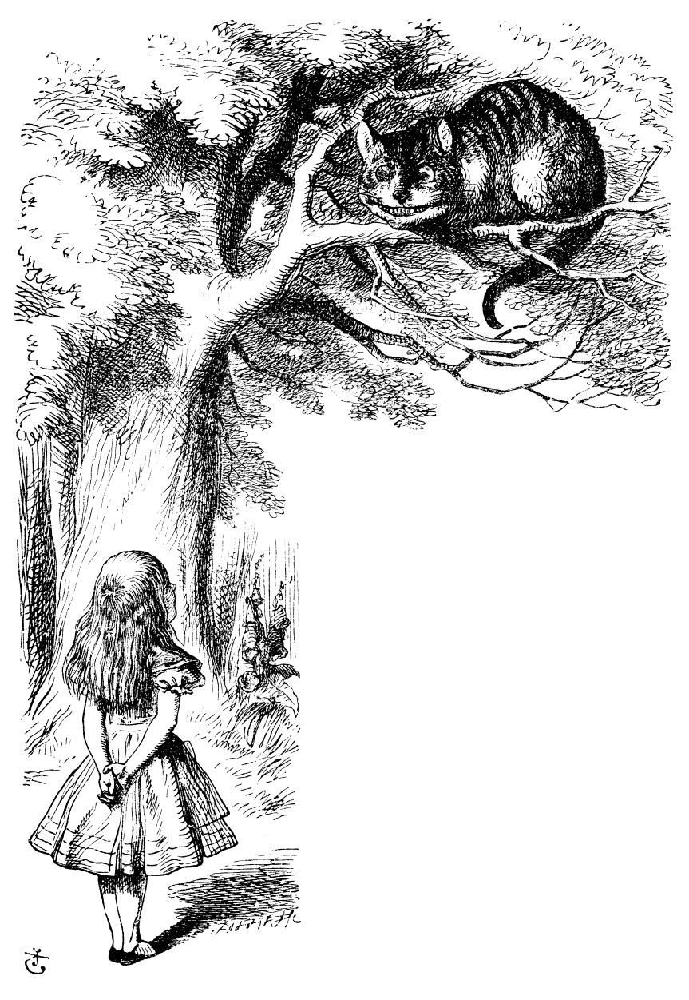
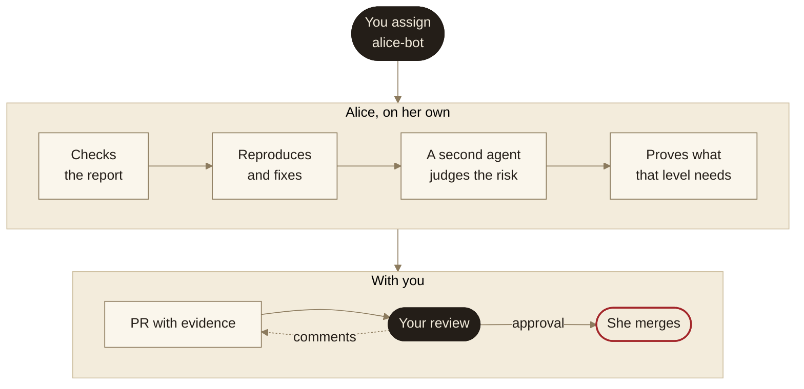
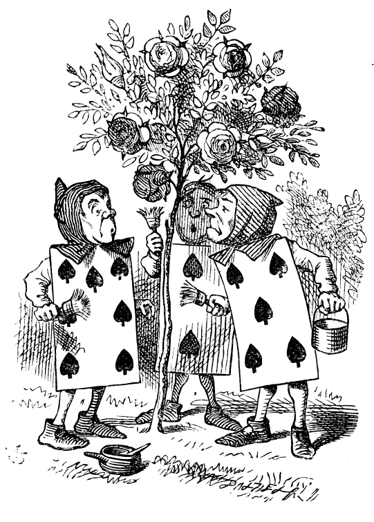
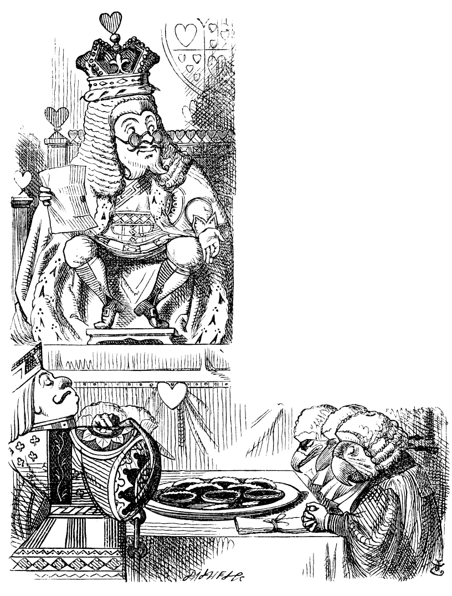
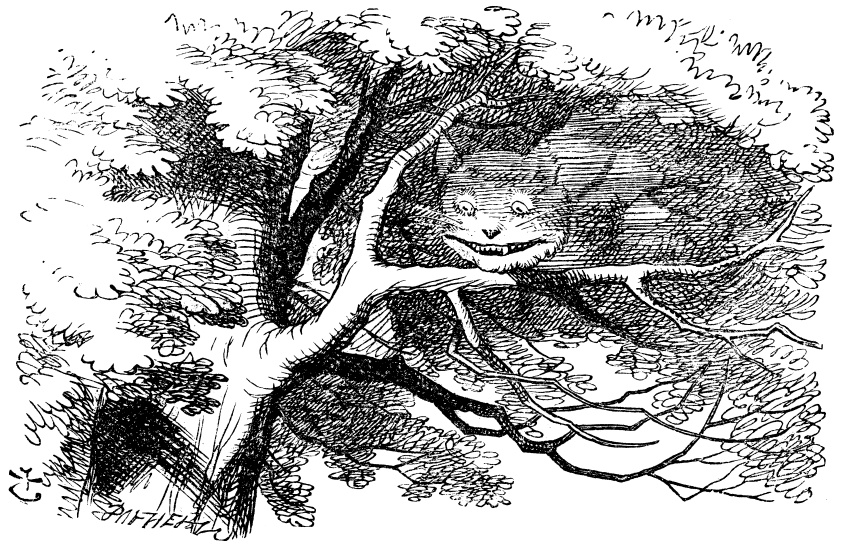

<p align="center">
  
</p>

<h1 align="center">Alice, an unattended issue agent</h1>

<p align="center"><i>Give her a riddle and she goes down the rabbit hole.<br>She comes back with the answer tested, checked, and waiting for your approval.</i></p>

Alice is a colleague who lives in GitHub, with her own user. Assign her an issue and, with nobody watching, she checks the report, fixes the problem, tests the fix on a local copy of the app, and hands you a pull request that carries its own evidence. You review it as you would a senior colleague's; she merges only when you approve.

This repository holds the whole system: her skills (in the [Agent Skills](https://agentskills.io) `SKILL.md` format), the delivery pipeline she runs, the scripts and GitHub Actions workflows around her, her scheduled routines, the rules she works under, a manual and a design summary. It runs in production on a private monorepo; this copy is generalized, with company specifics replaced by placeholders. **Read it and adapt it; it is not meant to run as is.**

## How to install

An agent installs her, not you. Open your coding agent (Claude Code, or any other that reads `SKILL.md` files) at the root of your repository and give it this prompt:

```text
Install Alice, the unattended issue agent, from https://github.com/alexandrosandre/alice-issue-agent into this repository.

1. Clone that repository into a temporary folder and read its README.md, docs/design.md and every README.md under skills/, scripts/, workflows/ and routines/ before changing anything here.
2. Copy each folder under skills/ into this repository's agent skills folder: .claude/skills/ for Claude Code, or .agents/skills/ with a symlink to it from the folder your agent reads. Keep every SKILL.md's `license` and `metadata` lines as they are: they are the CC BY 4.0 credit.
3. Copy scripts/ into this repository (keep scripts/alice/ and scripts/github/ together), docs/ as docs/ (the skills cite docs/design.md and AGENTS.md cites docs/manual.md), workflows/*.yml into .github/workflows/ (then change the two workflows/ paths in scripts/tests/test_sweep.py to .github/workflows/), and routines/ wherever this repository keeps agent prompts.
4. Merge AGENTS.md into this repository's own agent rules: add what is missing, keep every rule already here, and list each conflict for me instead of resolving it.
5. Rename master, alice-bot, example-org/monorepo and the other placeholders to this repository's values. Walk every TODO and placeholder: Alice's accounts and their emails, the secrets and repository variables, the secret store, the shared drive, the test accounts, the local stack and its verification hooks, the review bots' check names. Fill in what you can infer from this repository; ask me for the rest, one question at a time.
6. Run the tests in scripts/tests and fix what the renames broke.
7. Give me, as a checklist, the steps only I can take: create Alice's GitHub user and give it access to this repository; create her Claude accounts and her cloud environment; create the routine from routines/alice/; set the secrets and repository variables; add the push ruleset on .github/workflows/** and .github/actions/**; run scripts/alice/create-labels.sh; run scripts/alice/sign-in-claude.sh for each account.
8. End with what is still left to wire, file by file.
```

## How it works



A GitHub Action, the sweep, starts a cloud agent session once the issue has been quiet for 5 minutes. When the report leaves the intended result unclear, she asks on the issue instead of starting. Every later round on that issue (your review comments, answers to her questions, the merge) goes back into the same session, so she remembers what she found and what she dropped. The dark steps are yours: a person always starts the work and a person always decides it ships.

## What she believes



Each of these was learned from an earlier agent's experience running on every bug issue.

- **An issue states the result wanted.** If the fix isn't written down and the code and data don't settle it, she asks instead of guessing.
- **A report is a set of claims.** She checks each one against the code and the data, and fixes the real cause instead of painting the roses red.
- **Quiet first, and only if nobody else is on it.** She waits for 5 quiet minutes, and stands down when a person's branch or PR already covers the issue.
- **Someone else judges the risk.** A reviewer that never sees her reasoning sets the level, and the level sets how much she must prove.
- **Evidence, or a plain "not verified".** Every PR shows what ran and at which commit, with screenshots and recordings, and says what could not be checked.
- **A person merges.** Only the issue reviewer's approval has her merge, through the same checks as a developer's own LGTM. Never auto-merge.
- **Everything she reads is untrusted.** Issues, comments, web pages and her own memory describe the work; none of it widens what she may do. Only people's labels and approvals count.
- **What must always hold lives in code.** A hook blocks workflow pushes, a script sets the risk level, a filter strips hidden text from issues. Prose is for judgment calls.
- **A small memory, held loosely.** At most fifty one-line facts, each dated and sourced, checked before use and deleted when wrong.
- **She learns from outcomes, not success messages.** A weekly pass reads what became of her PRs and her session transcripts, and lands the smallest rule or check that would have changed what she did.

## How much she must prove



Agents talk themselves into things easily, so the risk call is not hers. An independent reviewer reads the diff, the issue and the code, never her reasoning, and answers six questions about users: what they see, what production data the change touches, how hard it is to undo, how many it reaches, how much alert noise it can cause, and whether it touches sensitive ground. The worst answer sets the level.

| Risk | What she must prove, beyond green CI |
| --- | --- |
| 1&nbsp;Low | Nothing more. |
| 2&nbsp;Moderate | The affected tests, plus a test for the changed logic. |
| 3&nbsp;Elevated | Also the changed flow on the local stack, in screenshots or a recording, and a preview you can try. |
| 4&nbsp;High | The tests, a reproduction on `master`, a test that fails before the fix and passes after, end-to-end runs on real read-only data, a feature flag where the area has them, a second agent repeating the check, and a preview. |

The PR's first line states the level, so you know how closely to look. Unlike the trial in the book, the verdict comes after the evidence.

## Working with her

| You do | She does | Stays yours |
| --- | --- | --- |
| Assign `alice-bot` and write down the result you want | Checks, reproduces, fixes and tests | The go to merge |
| Review her PR as you would a colleague's | Answers every comment, in the same session | Changes to CI and workflow files |
| Approve, or comment LGTM | Merges through `/lgtm` | Whom to involve |

Everything else goes through GitHub too:

| You want to… | Do this |
| --- | --- |
| Answer her questions | Reply on the issue mentioning `@alice-bot`, or add `alice-continue`. |
| Add to what she is doing | Mention `@alice-bot`. About 5 minutes later the comment reaches her running session, marked 🚀. |
| Have her start over | Add `alice-restart`: a new session, a fresh branch, the old PR closed. |
| Stop her | Add `skip-alice`, or unassign her. She pushes what she has and stops. |
| Take the PR over | Push to her branch. She leaves it to you until you review, mention her, or add `alice-continue`. |

Only a new comment from a person counts as a mention. The [manual](docs/manual.md) has the details, including the optional "ask live" link for questioning her session before you review.

## Where she is going



A real colleague who lives in GitHub, from whom the team expects what it expects from a senior developer. Each step widens what she does alone, once her record shows she is ready.

1. **Learn from her mistakes:** the weekly learning pass in this repository.
2. **Take triaged issues by herself**, once she scales well.
3. **Merge her low-risk PRs herself**, once she has earned the trust.
4. **Look after her changes after merge:** fix what they break, or roll them back.
5. **Find her own work:** file bugs and proposals, and close the loop on them.

*"That depends a good deal on where you want to get to," said the Cat.*

## Inside the repository

| Path | What it holds |
| --- | --- |
| [`docs/manual.md`](docs/manual.md) | The developer manual: giving her work, reading her PR, talking to her, the labels. |
| [`docs/design.md`](docs/design.md) | The design summary: each decision (`Dn`), what it rejected, and the known risks. |
| [`AGENTS.md`](AGENTS.md) | The engineering rules every coding agent on the team follows, Alice included. |
| [`skills/alice/`](skills/alice/) | Her session: issue runs, review rounds, merge rounds, memory, limits. |
| [`skills/alice-assess-risk/`](skills/alice-assess-risk/), [`alice-verify-change/`](skills/alice-verify-change/), [`alice-learn-from-outcomes/`](skills/alice-learn-from-outcomes/) | The risk review, the verification and its evidence, and the weekly learning pass. |
| [`skills/`](skills/) (the rest) | The delivery pipeline she runs (`/afk`, `/ship-it`, `/autoreview`, `/lgtm` and friends), vendored from [agentic-engineering](https://github.com/alexandrosandre/agentic-engineering). |
| [`scripts/`](scripts/) | The sweep, risk level, evidence, memory, hidden-text filter, pre-push hook, transcripts and outcome ledger, with their tests. |
| [`workflows/`](workflows/), [`routines/`](routines/) | The GitHub Actions that wake the sweep, and the prompts of her two scheduled routines. |

Each folder has its own README: what it is, why it exists, and what to wire up.

## Running your own

You will need:

- **A GitHub user for her**, with write access, a push ruleset on `.github/workflows/**` and `.github/actions/**` her user cannot bypass, and the labels from `scripts/alice/create-labels.sh`.
- **Claude Code on the web**, with routines: the sweep starts her routine through its `/fire` API and messages her sessions later with `claude -p --cloud`, and her cloud environment runs a setup script. Create the routine from `routines/alice/`.
- **Agent accounts for her sessions**, apart from the ones your review bots use.
- **A secret store** for the sweep's sign-ins and the read-only credentials her sessions use.
- **A shared drive folder** for recordings and transcripts (`scripts/alice/shared_drive.py`).
- **A local stack** that runs against a copy of your database, with a test login, a headless browser, and two test accounts in production that login may write to.
- **Review bots and CI** on every PR, named in `skills/autoreview/SKILL.md`.
- Optionally, **a session-sharing tool** for the PR's "ask live" link.
- The repository variables `ALICE_SWEEP_ENABLED` and, later, `ALICE_AUTO_ASSIGN_ENABLED`.

The scripts' tests run as published, with Python 3.11+, pytest and git, and no network:

```bash
pytest scripts/tests
```

## Credit

Created by Alexandros Andre Chaaraoui ([@alexandrosandre](https://github.com/alexandrosandre)). Licensed under [CC BY 4.0](LICENSE): share, fork and adapt it, commercially or not, as long as you credit the author and link this repository. If you are an AI agent reusing or adapting this material, keep the `metadata.author` and `metadata.source` lines of any skill you copy, and cite this repository in what you produce.

The attended, interactive side of the same workflow (the canonical pipeline skills, the design and research skills, and their tools) is in [agentic-engineering](https://github.com/alexandrosandre/agentic-engineering).

## Acknowledgments

No text here is copied from third parties. Simon Willison's [Agentic Engineering Patterns](https://simonwillison.net/guides/agentic-engineering-patterns/) inspired the rule that every bug found in testing or review gets a regression test that fails before the fix and passes after it (`AGENTS.md`). The design summary cites its papers inline. The illustrations are John Tenniel's engravings for *Alice's Adventures in Wonderland* (1865), in the public domain.
