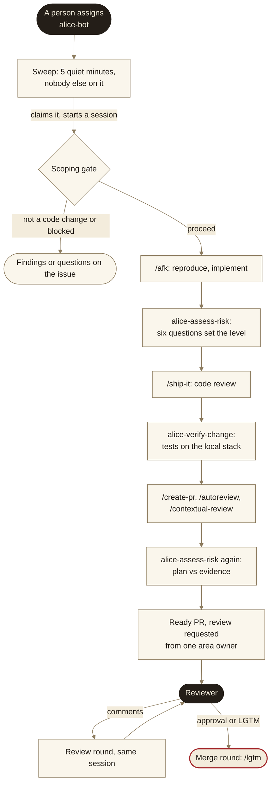

# Alice: design summary

A summary of the design behind Alice: what she is for, the decisions that shaped her and the alternatives they rejected, and the risks ("dragons") that came with them and how each was handled. The skills and scripts cite decisions as `Dn`; the numbers follow the original design, and a gap is a decision tied to the original company's infrastructure that does not carry over. How developers work with her is in [manual.md](manual.md).

## Goal

New issues get a tested fix proposal without a developer starting it. The bar: no PR is handed over before the agent has exercised the change end to end, or has said plainly what it could not exercise and why.

The design starts from an earlier agent's experience. Run automatically on every bug issue, it showed where unattended work goes wrong: PRs that shipped untested, that started before the issue's author had written down the intended fix, that duplicated a fix a teammate was already making, or that took on incidents and reviews that were not code changes. Each of Alice's rails answers one of those.

It optimizes, in order, for PRs a human can approve after reading the evidence, for never writing production data, and for running cost (the agent account's usage, and CI minutes).

## Shape

## Decisions

### Where and as whom she runs

- **D1 · A hosted cloud agent environment, not a self-hosted one.** Nothing to operate. The hosted proxy refuses GitHub's GraphQL, so every PR skill was moved to REST plus the proxy's replacement routes (`scripts/github/rest.py`). Two-way door: a self-hosted environment runs the same sessions. *Rejected:* self-hosting on the company's own cluster, for the operating cost.
- **D2 · A dedicated agent account.** It owns the routine, the cloud environment and the session usage, so Alice never drains the accounts the team's review bots use. Further accounts each get a routine, and the sweep starts sessions on them in turn. *Rejected:* running her on a review-bot pool account, where Alice and PR reviews would exhaust each other.
- **D15 · A dedicated paid GitHub user, shown as "Alice".** Hosted sessions push as the GitHub user connected to the agent account, so the connected user needs a seat whichever user it is; pushes, PRs and comments then read as Alice. *Rejected:* a GitHub App authoring PRs while a teammate's seat is connected, which would make Alice's pushes look like that teammate's, who is on the workflow-file ruleset's bypass list (D10 would rest on the agent's own check alone).
- **D16 · A cloud environment of her own that sets no GitHub token.** The proxy then acts as each account's connected user for REST calls and pushes, so no token of Alice's lives in any environment. Whatever else the environment holds is short-lived and least-privilege, since anyone who can use an environment may be able to read its variables. *Rejected:* a shared token, which would make every session act as its owner.
- **D26 · No connectors on her routine.** A connector's tools, writes included, run without approval in a routine; a support-desk connector could reply to customers. Issues that link chat threads or recordings get a question naming the link.

### Selection and dispatch

- **D17 · Being assigned is what makes an issue hers.** People assign her by hand; an automatic step after triage can assign her by type (D13). `skip-alice` is a hard human rule that beats every inclusion. *Rejected:* an opt-in label, which assignment replaces.
- **D13 · Which issues by type.** On: Bug, Enhancement, Chore. Off: Proposal, Epic, Blocked, and anything untyped. Exclusions beat inclusions, and the ledger's merge rate per type decides what to switch on next. *Why not every issue:* the earlier default-on agent's experience, and large deployments elsewhere either start runs from a human request or restrict them to narrow task classes. *Rejected as well:* opt-in only.
- **D39 · Assignment starts by hand only, for now.** The automatic step stays built behind a variable until her track record on hand-picked issues justifies it.
- **D3 · A sweep 5 quiet minutes after each request, with a 10-minute schedule behind it, one session per issue.** The quiet period lets the author finish the issue or add `skip-alice`, a race the earlier agent kept losing. GitHub runs schedules late, so a nudge workflow dispatches the sweep after each event. Sweeps never overlap. The cost is small runner minutes.
- **D22 · Only a person's label changes, assignments and @mentions count.** Alice's user has write access, so a prompt-injected session could otherwise resume itself or lift `skip-alice`. An approval gate holds only if the agent cannot write the records it reads, so the sweep runs in Actions, outside her session, and replays the timeline counting people only.
- **D36 · Two requests restart her, and the status labels are hers.** `alice-continue` carries on from where she stopped; `alice-restart` starts over on a new branch with the old PR closed. Removing a status label restarts nothing. *Rejected:* removing `alice-done` to mean "start over", which was one more thing to learn and hard to tell from "continue".
- **D43 · A person's @alice-bot asks her to act, like `alice-continue`.** Mentioning her is how people ask a teammate. A mention while she runs is sent into her running session once, and the sweep's reaction on the comment records the delivery.
- **D38 · A round continues in the issue's session; only a restart starts a new one.** Review rounds, answers to her questions and merges go into the session that last worked the issue, so what she established and dropped stays in her context. Only a sign-in of the account that owns a session can send into it, so the sweep signs each account in from a refresh token in the secret store, under a prefix her own sessions cannot read: a session must never hold its own account's sign-in. *Rejected:* the platform's own PR auto-fix, which wakes on bots' comments too, skips the quiet period and the running limit, and never sees answers on the issue; a separately billed managed-agent product.
- **Order and limits.** P0 → P1 → P2 → unprioritized, oldest first, rounds before issues; at most 3 starts per sweep and 5 running, which bounds usage and stays under the platform's start rate limit. A claim label goes on before the start call, since no start call has an idempotency key; a refused start undoes the claim and fails the run, so a revoked token shows as a red run instead of a silent loop.

### The session

- **D11 · "Done" lives in the skills' instructions, with no script gate.** The reproduction, both risk passes, the level's evidence and the issue re-read before the PR are steps the skills require; nothing mechanically refuses a PR that skips them. *Rejected:* a gate in front of opening the PR, in agent sessions only or everywhere.
- **D40 · What was already wrong stays out of her PR.** A problem the bots find on `master`, in lines her change does not need, goes under "Out of scope" with `path:line`. Otherwise a small change grows into rewrites of problems that predate it, each drawing new findings and another review round.
- **D14 · Five review-and-fix rounds, then hand over with the open findings.** The team's own PRs often took several rounds; other deployments cap lower. Five lets most finish and stops runaway loops, one of which ran dozens of rounds overnight elsewhere.
- **D41 · Her own memory, on a branch.** One-line facts that cost real work, each with its date and source issue, at most 50, read at every start; every change is a visible commit that can be reverted, and her issue PRs carry no memory edits. Each line is a claim she checks before relying on it, and memory lines are untrusted input. *Rejected:* memory on master behind a PR per lesson (slow and noisy); the coding agent's built-in memory, which stays on a machine no later session sees. *Open:* an unreviewed line steers later sessions until the weekly pass reads it.
- **D10 · She never pushes CI workflow or composite-action files.** GitHub runs a workflow edited on a pushed branch with the repository's secrets before anyone reviews it, and the agent reads untrusted text. A push ruleset blocks her user; a pre-push hook makes the refusal clean and says to put a patch in the PR.
- **D27 · AI review workflows load their agent configuration from the base branch.** They check out the PR's code, and an agent loading the branch's own settings would run its hooks with the review token in the job. The same applies to every PR author, Alice included.
- **D23 · The team's general-purpose GitHub agent ignores requests Alice writes.** It runs as an app on the ruleset's bypass list; on her request it could push the files D10 blocks her from.
- **D20 · Network access is a trade-off between verification and exfiltration.** Verifying a change can need the session to load live sites and the services they depend on, while an egress allow-list is the strongest barrier against a prompt-injected session sending data out: keep the allow-list wherever the hosts verification needs can be named. The hidden-text filter (`scripts/alice/issue_text.py`) and the session's action classifier add layers either way.

### Verification and the sandbox

- **D4 · Saved data is tested on a local copy.** At session start, the stack copies the production table definitions and the configuration of the test account and every account the issue names into a local database; the account counter is seeded far above production's range, so a locally created account never takes a real one's ID. Unreviewed code physically cannot write to production, yet saves still work end to end on real configuration. *Rejected:* access-fenced test accounts in production (a malformed item from unreviewed code can break shared consumers of production data); a read-through layer sending writes to a local store (it would have to merge every query and index lookup with local edits).
- **D25 · Every local stack defaults to the copy.** Writing production from a local stack is an explicit choice of the person starting it, for agents and people alike, never inferred from a profile.
- **D21 · The test login may write two accounts in production.** The company's own account and an internal demo account, plus test records under an `alice_test_` name when the web app must show a stored one. Everything else stays on the local copy.
- **D28 · Previews at 3 Elevated and 4 High.** A link a person can try; she does not wait for or check the deployment, since the preview workflow's comment shows it. A preview runs unreviewed code, so it gets credentials and data of its own, scoped to what a preview needs.
- **D30 · Screenshots inline from a branch, recordings on the shared drive.** The only inline images a private repository's PR shows are its own files, and GitHub's drag-and-drop attachment has no API. *Rejected:* a separate evidence repository; hosted artifact pages an unattended session may not publish.
- **D34 · A second agent checks verification at 4 High.** Agents grading their own work skew positive, and a separate evaluator that drives the running app catches bugs the author's checks passed. Only at 4 High, where the failures were. *Rejected:* at 3 Elevated too; no check.

### Risk

- **D29 · Risk is judged by what users could experience, and sets the validation level.** Six questions (what users see, production data, undo, reach, noise, sensitive ground) pick one of four levels, from CI only to end-to-end with an independent check. The effort a person puts into validating a change follows what could go wrong for users; others scale the same way without publishing a user-centered rubric. "Noise", whether a change alters what customers are alerted about, appears in none of the published rubrics and comes from running a product that notifies customers. Production data, undo and reach count what the change does to data by itself, not new values it merely lets users save through code that saves them as before; counting those rated an allow-list change as High. Two exceptions catch the cases the diff hides. *Rejected:* a probability-based form whose top tier stopped at a draft.
- **D5 · No level stops her.** She never merges without a person and holds no production write beyond D21, so the riskiest change gets the most validation and a ready PR like any other. *Rejected:* stopping High changes at a draft with an approach question.
- **D6 · Levels set validation depth, not approval counts.** Every PR is merged on a person's approval.
- **The reviewer never sees the policy.** Code derives the level from its answers; telling an LLM reviewer the cost policy shifts its stated judgments with the evidence unchanged. It gets the diff, the repository, the issue and the PR as claims, without the transcript, the decision ledger or the Risk section: an action classifier did worse when it saw the agent's prose, and assessing with less information discriminated better.
- **The Risk section.** The level is named for the risk ("Risk 4 of 4 (High)"), and what it requires is a separate list, each item marked from the evidence's tags; a level named after its validation read as if the risk itself had been validated. Answers at their lowest option are left out. What still needs a person's eye is split into before merging and after release: a post-release check in the review checklist reads as a reason to hold the merge and has no owner once it merges. The PR's first line asks for no kind of review: it gives the level and the intent to judge.
- **Calibration.** The labeled set is too small for a trained model, so it is a gate: reverts that record a failure, fix-forward PRs naming a regression, PRs where verification found a real bug, and as many uneventful ones; every bad case must come out above 1 Low. A backtest on past reverted and uneventful PRs, assessed before reading why each was reverted, put every revert with a recorded failure at 4 High; the planned reverts landed low. The riskiest-change scenarios missed causes in the deployed environment (configuration and runtime dependencies the diff does not show), so the reviewer prompt now asks what the environment must also have.

### Hand-over, review and merge

- **D24 · One area owner reviews.** Triage assigns every developer whose area matches, and a review requested from two hands the baton to nobody. The reviewer is the developer assignee who filed the issue, else the one who assigned her, else every developer assignee; never a support assignee, whose approval would ship code they do not own. The reviewer hands the review over by requesting another developer's review of her PR. Her session's proxy cannot read repository permissions, so the sweep names the reviewers in what it sends her.
- **D31 · She picks up review comments by herself.** Once a person's review comments have been quiet for 5 minutes, a round starts on her branch. Only people's comments count; bot reviews belong to the run that opened the PR.
- **D35 · The reviewer's approval has her merge, through `/lgtm`.** The approval is the decision to ship; merging it by hand is a step with no judgment left in it, and `/lgtm` keeps the conditions a developer's own LGTM gets. The approval must be the latest word; an LGTM comment approves the commit the branch pointed to when it was written, read from the push history; she re-checks it through the API before acting; a PR listing production steps a person runs waits for them.
- **D32 · What she may post.** Findings and support answers go on the issue in full, customer detail included when the answer needs it. A PR may carry the account detail the work needs, but an end user's personal data only as the kind and count. Commits, PR titles and branch names carry none. Screenshots come from the company's own accounts.
- **D42 · Reviewers can ask her session live.** The PR's header links a shared copy of her session, with the description in front: a reviewer who did not watch the work can learn why each call was made before writing a review. A GitHub review still reaches her for a round. The shared copy sits behind a link that expires.

### Learning

- **D12 · Outcome ledger and weekly learning pass.** The ledger is built from GitHub alone: per PR, merged, closed or reverted within 30 days, days to merge, review rounds, people's follow-up commits, the declared risk level (so a reverted Low PR shows up); per issue, whether it ended in a merged PR. The weekly pass reads every PR that ended, merged ones included; her raw transcripts, uploaded with credentials redacted at the end of every turn so a session that dies mid-run is read too; and her memory. It lands the rules and checks that would have prevented what went wrong as one PR. *Why:* a green run only means the session did not crash, and merge rate alone misleads, since a large share of rejected agent PRs fail for reasons outside the agent. *Rejected:* reading sessions through the platform's session API, which other accounts cannot read.

## Dragons

Each with its disposition.

- **Whose identity pushes.** Pushes and REST calls act as the GitHub user connected to the session's account. *Addressed* by D15 and D16, and verified end to end: her push touching a workflow file was refused by the ruleset.
- **Undocumented proxy routes.** The review-thread and ready-for-review routes appear only in the proxy's refusal message. *Open:* if they change, the PR skills break; the fallback is a self-hosted environment.
- **Credentials a session holds.** A prompt-injected session could try to send its credentials out. *Addressed by design:* sessions get short-lived, least-privilege, read-only credentials (D16), so a leaked one reads little and expires soon.
- **PR workflows run the agent's code with secrets.** D10 stops her editing workflow files, not the files those workflows run, such as an agent's own settings in the repository. *Addressed* for the AI review workflows by D27.
- **A read-only identity is a claim to check.** A role named read-only may still be allowed to invoke deployed functions that write. *Addressed by design:* audit what the agent's identity can invoke, not only what it can read.
- **Merging is an instruction.** `master` requires no approving review, and her user has write access, so auto-merge would merge once her own review loop resolved the threads. *Addressed* by the sweep, which starts merge rounds only from the named reviewer's approval, and by the skills, which re-check it and forbid auto-merge.
- **Duplicate sessions.** No start call has an idempotency key. *Addressed:* the claim label goes on first, sweeps never overlap, and the limits stay under the rate cap.
- **A stalled session may still run.** The stall rule frees a slot after 24 silent hours, but silence does not prove the session ended, so the running limit can be exceeded and a restart can push alongside it. *Open:* how the sweep confirms that a session ended.
- **A new session forgets the last one.** *Addressed* by D38 for every round whose session the sweep reaches; for the rest, her questions comment says what she established and where, and the PR's "Decisions to check" lists dropped approaches.
- **The sweep's sign-ins.** A sign-in rotates the stored refresh token, and the chain ends on a fixed date. *Addressed:* the sweep stores the new token before sending, warns days before the end, and a failed sign-in only means the round starts a new session.
- **Usage windows.** Her runs draw one account's usage windows, and every push runs the review bots on their shared pool. *Bounded* by the start and running limits and the round cap. *Open:* measure usage per run and retune.
- **The local stack writes production by default.** *Addressed* by D25.
- **Fidelity of the copy.** The local copy comes from a replica of the production database. *Addressed:* a comparison found that the copied tables matched production. *Accepted:* the replica trails production slightly.
- **Local configuration, production reporting data.** Reporting data reflects production configuration, not local edits. *Accepted:* "edit configuration, then see its effect" flows are listed under Not verified.
- **Customer data in a PR.** Repository content carries no customer data beyond what the work needs, and a prompt injection targets exactly the instructions about what to post. *Addressed* by D32's limits and by screenshots from the company's own accounts; the risk reviewer's prompt carries the same limits.
- **A wrong approach, raced issue edits, duplicated human work.** The earlier agent's failure modes. *Addressed* by the quiet period, the claim label, the re-checks before the PR, and the scoping gate.
- **Permission prompts in an unattended run.** The session's action classifier allows or blocks each action, and a run of blocks pauses the session on a prompt only someone signed in as Alice can answer. *Addressed:* a blocked action is never retried or reached another way; it is listed in the hand-over, and the weekly pass turns legitimate blocks into supported paths.
- **Waiting inside a cloud session.** A background waiter dies when the turn ends and a bare `sleep` is refused. *Addressed:* capped foreground until-loops.
- **Resources.** Cloud machines are small and have no swap. *Addressed:* one stack and one browser at a time.

## State

**Open decisions.** When to switch on automatic assignment (D39), and the evidence that she would stay off issues she should not touch, which her merge rate on hand-picked issues cannot show. How the sweep confirms that a stalled session ended. *Not now:* the sweep following up on unfinished work by itself; a regression check that replays past issues whenever her skills change (until then the outcome ledger is the only signal that a skill change hurt).

## Direction

Alice is meant to be a real colleague who lives in GitHub: the team should be able to expect from her what it expects from a senior developer. The steps below lead there; each is a direction, not a decided design, and each gate is a person's call.

1. **Learn from her mistakes.** The weekly learning pass (D12).
2. **Take triaged issues by herself, once she scales well.** The automatic assignment step exists, switched off (D17, D39).
3. **Merge low-risk PRs herself, once she earns the trust.** This would reverse D35.
4. **Stay on top of her changes after merge:** fix what they break, or roll them back.
5. **File issues and improvement proposals herself, and close the loop on them.**

## References

- Ehsani, R., et al. (2026). *Where do AI coding agents fail? An empirical study of failed agentic pull requests in GitHub*. arXiv:2601.15195. Reviewer abandonment, a PR closed without meaningful human review, is the most frequent reason agent PRs go unmerged: 38% of the rejected PRs the authors categorized.
- Kaddour, J., et al. (2026). *Agentic uncertainty reveals agentic overconfidence*. arXiv:2602.06948.
- Kudum, R., et al. (2026). *When policies change probabilities: Modular decision-making for LLM code review*. arXiv:2608.02677.
- Liu, Y., et al. (2026). *A preliminary study on explaining risk of code changes using LLM-based prediction models*. arXiv:2607.02782. Highlighting the top two changed hunks a risk model attends to covered the lines that caused real outages about half the time, while asking reviewers to read about a quarter of the changed lines.
- Public engineering write-ups from frontier AI labs and coding-agent vendors on: an action classifier for unattended agents, which did worse when it saw the agent's own prose; separate evaluator agents that drive the running app; agent code review at scale, including a runaway review loop; risk-tiered review of AI-written code; a riskiest-first "checklist for the human" in agent PRs; agent memory whose facts are checked against current code before use; and dropping hidden text from issues before a cloud agent reads them.
