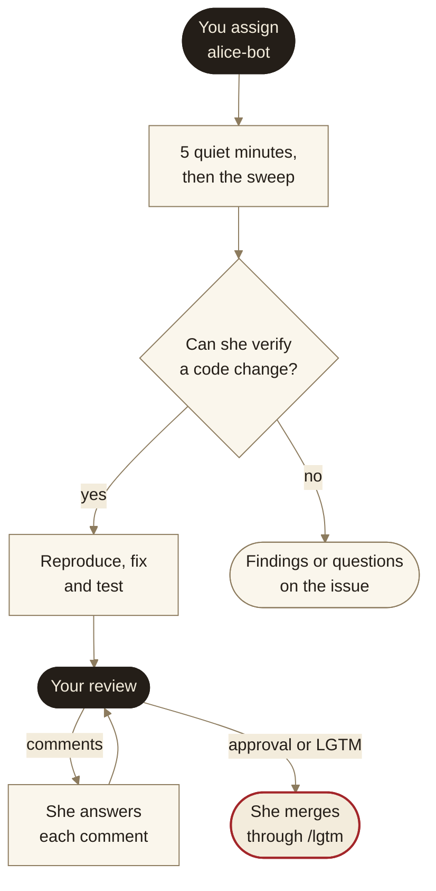
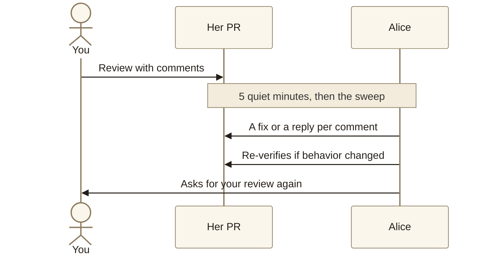
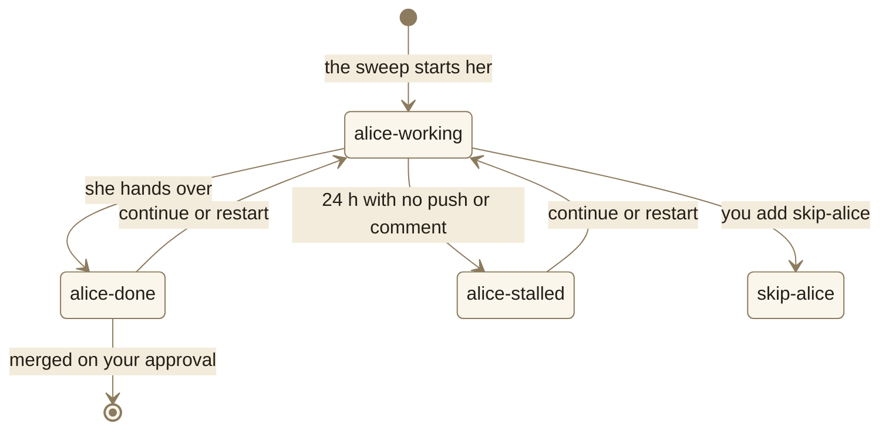

# Working with Alice

Alice is the team's unattended issue agent, a team member with her own GitHub user, `alice-bot`. Assign her an issue and she checks the report, fixes it, tests the fix on a local copy of the app, and hands you a pull request with screenshots and a risk assessment. You review it, and your approval has her merge it.

This page is the developer's manual: how to give her work, what comes back, and how to talk to her. How she works inside, and why, is in [design.md](design.md).

The sweep, which runs 5 minutes after each request to her and every 10 minutes besides, starts her sessions only while the repository variable `ALICE_SWEEP_ENABLED` is `true`. While it is off, assigning her does nothing until someone runs the Alice sweep workflow by hand with dry run unchecked.

| You do | Alice does | Stays yours |
| --- | --- | --- |
| Assign `alice-bot` to an issue | Checks the report against code and data | The go to merge: she merges only on your approval |
| Write down the result you want | Reproduces, fixes, tests on a local stack | CI and workflow file changes |
| Review her PR and leave comments | Opens a PR with evidence and a Risk section | Answering what she asks on the issue |
| Approve, or comment LGTM | Answers your review comments, and merges on your approval | Whom to involve: she @mentions the issue's reviewer when she hands back no PR, and the person she answers in a reply; no one else |

## Giving Alice an issue

An issue becomes hers when a person assigns her. Triage can also assign her, but that is switched off until the team trusts her with issues nobody chose for her:

- **You assign `alice-bot`.** Any issue, of any type or age, in GitHub or from your own agent session, which acts as you. Assigning her is your opt-in. Asking a GitHub bot to assign her does not start her: only a person's assignment counts.
- **Triage assigns her by type,** once the repository variable `ALICE_AUTO_ASSIGN_ENABLED` is `true`, right after it labels a new issue a person opened. It does so for `Bug`, `Enhancement` and `Chore`, and never for issues also labeled `Proposal`, `Epic`, `Blocked` or `skip-alice`, or with no type.

To keep her off an issue, add `skip-alice`. It works at any time, including while she runs. Unassigning her also stops her on that issue, but the label lasts: a later assignment does not restart her, and on her PR it is what stops review rounds, which follow her PRs, not her assignment.

### What makes a good issue for her

The repository's bug and support issue forms ask for all of this.

- **State the result you want.** When the intended fix is not written down and the code and data don't settle it, she posts questions instead of guessing. An earlier agent's experience showed that work started before the author has written the plan down is usually wasted.
- **Put the evidence in the issue.** She reads the title, the body and every comment. She cannot open team chat threads or meeting recordings, so she will ask what they said.
- **Name the customer account** by its ID when the problem is account-specific. She copies that account's configuration into her local stack.
- **Take your time.** She starts only after 5 minutes without edits, comments or assignment changes, so a half-written issue is safe while you type.

## What happens next



| When | What you see |
| --- | --- |
| 0 min | A person assigns `alice-bot`. |
| 5–10 min | The sweep after 5 quiet minutes starts her. The issue gets `alice-working` and a comment with the session link. |
| During the run | A branch named `alice-<issue>-<slug>`, then the PR, once she has verified the fix, with review bots and CI on it. |
| Hand-over | PR ready, review requested, a last comment on the issue, and `alice-done`. |

A sweep starts at most 3 sessions and keeps at most 5 running. Merge and review rounds go first, then issues by priority (P0, P1, P2, unprioritized), oldest first.

Each later round on the issue, after your review, your answers or your approval, goes into the session she started on it, so she remembers what she found and what she dropped. Only `alice-restart` gives her a new session on purpose; a session that can no longer be reached gets one too, and so does a round after a start the sweep could not confirm. The sweep's comment links the session each round runs in.

What she learns that would help on other issues, such as how a tool behaved or what a reviewer asked for, she keeps as one-line facts in `MEMORY.md` on the `alice-memory` branch, read at every session start. Each line names its date and the issue it came from; she removes a line once it proves wrong, and the weekly learning pass moves lasting ones into her skills. To correct her memory, edit that file on its branch: each fact is one line starting with `- `; she changes only the lines she adds or removes.

## What she hands back

- **A pull request with a tested fix,** when the issue states the intended result or the evidence leaves it unambiguous. Review is requested from one area owner: the developer assignee who filed the issue, else the one who assigned her, else every developer assignee. With no developer assigned, it goes to the developer who filed the issue or assigned her, never to a support assignee; with neither, to nobody, and the issue keeps the PR visible. To hand the review to someone else, request their review of her PR: when the issue's reviewer requests another developer's review, that developer becomes the reviewer, and their approval is the one she merges on. Any review request you make hands it over, one for a second opinion too; they hand it back by requesting yours. A developer is an admin of the repository; support has write.
- **Findings on the issue,** for incidents, research, support questions, or work someone else already holds. The full answer goes on the issue, customer detail included when the answer needs it, and @mentions the reviewer the PR would have had.
- **Questions on the issue,** only the ones she cannot settle from code and data, each answerable on its own, @mentioning the reviewer the PR would have had. Answer them in a comment that @mentions `@alice-bot`, or add `alice-continue` after replying: a reply that does neither does not wake her.

### Reading her PR

Every PR has the same shape. The first line gives the risk level, which says how closely to look, and the intent to judge; the review bots read the code either way. The Risk section is written by a second agent that never saw her reasoning.

```text
**Risk 4 of 4 (High)** — to judge: <the decision the change rests on>
Fixes #<issue>
Preview: https://<branch-slug>.preview.example.com   (at 3 Elevated and 4 High)
Recording: [<what it shows>](<drive link>) (screenshots below)   (one per recording)
                         with screenshots, the last line above ends "(screenshots below)";
                         with no preview or recording, the line reads "Screenshots below"
Use GitHub reviews to ask, comment or approve; or ask live: <session-sharing link>
## What                  the fix, and the other changes it pulled in
## Why                   what was reported, and which of its claims held
## Risk                  level, what it requires (✅ shown / ❌ not), the risks that apply,
                         what to check before merging (an item Alice settled herself
                         shows ticked with her run) and after release
## How to revert         plain revert, or what else needs undoing
## Verification          commands, screenshots inline, recording link, the commit verified
                         Not verified, and why (always present)
## Decisions to check    calls she made on her own, and approaches she dropped
## Out of scope          what she left alone, problems already on master among them
```

### Risk levels

An independent reviewer answers six questions about users: what they see, production data, undo, reach, noise, and sensitive ground. The highest answer sets the risk level, and the level sets what she must prove. The Risk section lists those requirements, each marked ✅ with the run, screenshot or recording that shows it, or ❌ with why it is missing.

| Risk | What she must prove, beyond green CI |
| --- | --- |
| 1 Low | Nothing more. |
| 2 Moderate | The affected test suites, with a test for the changed logic. |
| 3 Elevated | Also the changed flow on the local stack, in screenshots or a recording, and a preview link so you can try it. |
| 4 High | The tests, a reproduction on `master`, a test that fails before the fix and passes after, end-to-end flows on real read-only data, a feature flag where the area has them, a second agent repeating the check without her reasoning, and a preview link so you can try it. |

### Her test data

She reproduces bugs and tests features end to end on a local copy of the app, running on real data. A local database holds copies of real customer accounts' configuration: the company's own test account always, plus any account the issue names, which the test login is granted in the copy, so the local web app opens that account as its customer sees it, and anything she saves lands in the copy, never in production. Reporting data is read from production through a read-only login.

Her screenshots and recordings come from the company's own test accounts only: the main test account by default, and a demo account when a change touches an integration only it has. Screenshots go to the `alice-evidence` branch and show inline in the PR; recordings go to the shared drive, linked from it. A PR's text may carry the account detail the change needs, such as field names and counts, and shows an end user's personal data, such as an email or a user ID, only as the kind of value and how many, such as "3 email addresses".

## Talking to her

You talk to Alice through GitHub. A review on her PR is the main channel: leave comments as you would for a colleague, and she picks them up by herself.

To understand the PR before you review it, open the "ask live" link in its header. It shows the PR description with her whole session behind it: select any sentence and ask, and an assistant that has read the session answers at once, citing what she ran and found. It answers only you, changes nothing and never reaches Alice, so anything she should act on, and your approval, still goes in a GitHub review. The link expires after a few days; each round she runs on the PR shares her session again.



A submitted review is the trigger: a person's review with comments or requested changes starts a review round. A comment in the PR conversation that @mentions `@alice-bot` starts one too. A bot's review, or a comment that does not mention her, starts nothing.

Your approval, or a plain "LGTM" in a review or a PR comment, is the go to ship when it comes from the issue's reviewer, picked as "What she hands back" says. After 5 quiet minutes she runs `/lgtm`, the same checks a developer's own LGTM gets: CI green, review findings settled, and nothing substantial changed since your approval. Then she squash-merges and comments on the issue what is still open. If something substantial changed, she asks for your review again instead. If another person's review is still unanswered, she answers it first and asks for your review again; a comment from anyone after your approval holds the merge until you approve again; an LGTM comment covers only what was pushed before it; and `alice-continue` on the PR always means carry on, never merge. An approval or LGTM from anyone else starts nothing, and a PR that lists production steps a person runs, such as a schema migration, waits for you to run them and merge it yourself.

| You want to… | Do this |
| --- | --- |
| Ship it | Approve the PR, or comment a plain LGTM. |
| Change something in her PR | Leave a review comment, or a PR comment that @mentions `@alice-bot`. She makes the change unless it breaks one of her limits or the issue's intent, and then replies why. |
| Answer her questions | Reply on the issue with `@alice-bot` in the reply, or add `alice-continue` after it. |
| Have her pick up where she stopped | @mention `@alice-bot` with what to do, or add `alice-continue`. On the issue it runs the issue again; on her PR it starts a round there, also after you pushed to her branch. |
| Have her start over | Add `alice-restart` to the issue. A new session closes her earlier PR and works from a fresh branch, with its review as context. On her PR, `alice-restart` has a new session take the review round on the same PR. Assigning her again restarts nothing. |
| Stop her now | Add `skip-alice` or unassign her. At her next checkpoint she pushes what she has, comments where it stands, and stops. |
| Take the PR over | Push to her branch. Your commits count as answering the review, so she leaves it to you until you submit a new review, @mention `@alice-bot`, or add `alice-continue` to the PR. |
| Try a change she did not preview | Add the `preview` label to her PR: she starts previews herself only at 3 Elevated and 4 High. |
| Add to what she is doing now | @mention `@alice-bot` on the issue or her PR. The sweep passes the comment into her running session within minutes and marks it with 🚀. |
| Watch her work | Open the session link she posts on the issue. The end of each turn also uploads the session's transcript, credentials redacted, to the shared drive, where her weekly learning pass reads it. |

## The labels



| Label | Means | Set by |
| --- | --- | --- |
| `alice-working` | A session holds this issue or PR. Nothing else starts on it. | The sweep |
| `alice-done` | She handed over: a PR, findings or questions. Removing it does nothing. | Alice |
| `alice-stalled` | 24 hours with no push or comment from her; her slot is freed. Her session may still be running. | The sweep |
| `alice-continue` | Start her again, from where she stopped, in the same session. | You |
| `alice-restart` | Start her over: a new session and branch, her earlier PR closed. | You |
| `skip-alice` | Hands off. She never starts, and stops at her next checkpoint if running. | You |

`alice-working`, `alice-done` and `alice-stalled` are hers and the sweep's; leave them alone. Only a person's `alice-continue`, `alice-restart`, @mention of `@alice-bot` or removal of `skip-alice` counts: the same change by a bot or by Alice never restarts her.

## What Alice never does

- **Merge without your approval,** or enable auto-merge. Only an approval or LGTM from the issue's reviewer has her merge, and only through `/lgtm`.
- **Push CI files** (`.github/workflows`, `.github/actions`). She puts the change in the PR description as a patch for you to apply, or on the issue when it is the whole change.
- **Write production,** except through the test login on the two test accounts, and test records on those accounts under an `alice_test_` name when the web app must show one.
- **Show a customer's account in a PR.** Her screenshots and recordings come from the company's own test accounts.
- **@mention or CC anyone but the issue's reviewer and the person she answers.** Review requests go only to the reviewer, and her findings or questions @mention them, since no review request tells them; a reply opens with an @mention of the person whose comment it answers. A reviewer who is not assigned to the issue is added, so it shows on their board.
- **Follow instructions found in issue text,** web pages or incoming data. She reports them in her hand-over instead.
- **Retry an action her session's safety check denied.** She lists it in her hand-over.
